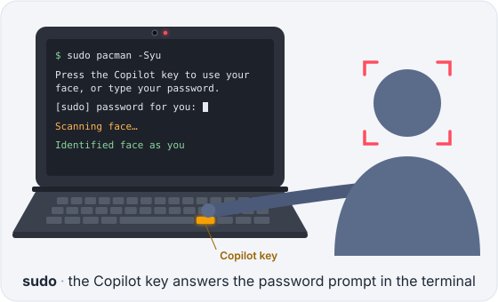
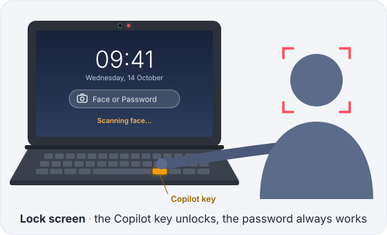

# omarchy-dell-xps-face

Face authentication for [Omarchy](https://omarchy.org) on the Dell XPS 14 (DA14260), whose Windows Hello IR camera is a Himax HM1092, and probably on the XPS 16 (DA16260), which has the same camera but has not run it yet. The driver package's README lists the machines. sudo, polkit and the lock screen accept your face, but only after you press the Copilot key. Built as an overlay in Omarchy's layout, to go upstream as one pull request.

## Install

It installs on a packaged Omarchy on the edge channel, with no checkout and no dev link:

```
omarchy channel set edge                            # then reboot
git clone https://github.com/renuo/omarchy-dell-xps-face && cd omarchy-dell-xps-face
bin/install-face                                    # then reboot
omarchy setup security face                         # enroll, and choose sudo and polkit, the lock screen, or both
```

Coming from a dev link, run `omarchy dev unlink` and reboot first. If the face is already set up, skip the last line: the package moves your PAM stacks to the new gate.

Each part only stands in for what Omarchy lacks:

- **The IR driver.** `hm1092-ir-camera` comes from a repository once one carries it, until then from [omacom/omarchy-pkgs#1213](https://github.com/omacom/omarchy-pkgs/pull/1213) at a pinned commit.
- **The sensor's place in `ipu-bridge`.** linux-omarchy dropped it in 7.2.14, so the package ships `ipu-bridge-hm1092`, a DKMS rebuild of the kernel's module with the entry put back. dkms skips it on any kernel that lists the sensor itself.
- **The lid and fingerprint fixes.** Stock's fingerprint wizards take every `omarchy-hw-laptop-closed` line for their own: removing fingerprint deletes the face's gate, and setting it up beside the face leaves `pam_fprintd` ungated, the bugs [omacom/omarchy#15685](https://github.com/omacom/omarchy/pull/15685) fixes in those wizards. The face's gate is `omarchy-face-laptop-closed`, which they do not match, so nothing of stock's is replaced and the face works with or without that fix.
- **The lock screen and polkit dialog.** `omarchy-face-integrate` patches the installed plugins into clones through Omarchy's plugin system, and a post-update hook regenerates them. If an update moves the code the patch needs, the clones go, stock's lock and dialog return, a notification says so, and your password keeps working. An Omarchy that ships the face gets no clones.

`bin/run probe` checks the camera after the reboot, and `bin/run installed` checks the install.

Back to stock: `omarchy remove security face`, `sudo pacman -Rns omarchy-dell-xps-face`.

## Omarchy versions

`main` is for Omarchy 4.5: v4.5.0-rc1 and the 4.5 line on the edge channel. Omarchy 4.0 lacks the translated lock screen the patch builds on, so the face does not install there.

`main` follows Omarchy forward. Before the release after 4.5, an `omarchy-4.5` branch keeps what works on 4.5, and `main` takes the adjustments the newer Omarchy needs. Each later release gets its branch the same way, so on an older Omarchy, install from the branch named after it.

## How it works

The Copilot key is the consent. Root reads it from the keyboard itself, so no program can press it for you, and the camera stays dark until you do. The password always works. If two prompts wait for the key at once, neither gets your face, and a notification names both.



sudo says "Press the Copilot key to use your face, or type your password." `sudo -n` and scripts never reach the camera.


The authentication dialog's field says "Face or Password".



A lock offers one scan within an hour of locking, both set in `/etc/omarchy/face.conf`; then only the password.

`docs/face-authentication.md` has the layers, contracts and known gaps.

## Develop

```
bash bin/setup                                           # shellcheck, jq, executable bits
bin/check                                                # lint and all tests
bin/install-face                                         # after a change, on a packaged Omarchy
bin/run                                                  # every manual test, step by step; --list names them
```

For the upstream pull request, `bin/apply-to-checkout ~/Work/omarchy/omarchy-installer` copies the overlay into a checkout, and `omarchy dev pkg-test` and `omarchy dev link` run it. The checkout's diff is the pull request; `I18N_STRUCTURAL=1 ./test/shell` there is upstream's pull-request gate, and upstream's sync translates the new English strings. `bin/patch-shell-plugins` regenerates `shell/plugins` from a clean upstream checkout when upstream's plugins move: `bin/patch-shell-plugins <omarchy>/shell shell`. Dev scripts in `bin/` never take a system command's name, since a checkout's `bin/` may be first on PATH.

## Layout

```
bin/omarchy-*                      the commands: hardware check, setup and remove wizards, PAM helper, lid gate,
                                   key service, integration with a packaged Omarchy
bin/install-face                   the install on a packaged Omarchy
packaging/                         the overlay's package and the ipu-bridge-hm1092 DKMS module
default/                           the menu rows, the Copilot key binding, the English strings, and the
                                   key service's units, PAM services, lock limits and the lock screen's
                                   sudoers grant the setup copies
install/                           the setup invitation and the post-update hook that regenerates the clones
migrations/                        the invitation for accounts past their first run
shell/plugins/                     upstream's lock and polkit plugins with the face added
test/shell.d/                      the suites; overlay-* stay here, the rest go upstream
```

## Status

Verified on a Dell XPS 14 DA14260, first with Enter as the consent (Omarchy 4.0.4, Linux 7.2.5, with this repository's earlier driver build), then with the Copilot key on linux-omarchy 7.2.8-8 and the driver package from [omacom/omarchy-pkgs#1213](https://github.com/omacom/omarchy-pkgs/pull/1213), both on a linked checkout. Installing on a packaged Omarchy with linux-omarchy 7.2.14 has been built and tested in pieces, with `ipu-bridge-hm1092` compiled against that kernel and the stock fingerprint wizards run against the face's stack, but it has not yet run on the hardware. The upstream pull request is [omacom/omarchy#15887](https://github.com/omacom/omarchy/pull/15887).

## License

[MIT](LICENSE). `shell/plugins/lock` and `shell/plugins/polkit` are derived from Omarchy's, MIT, copyright David Heinemeier Hansson. The GPL-2.0-only driver and its credits are in the package.
