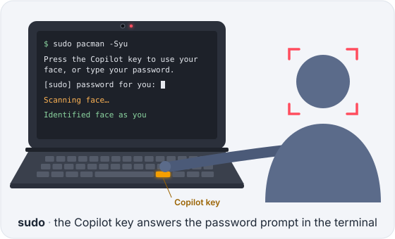
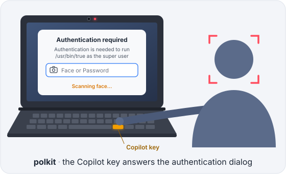
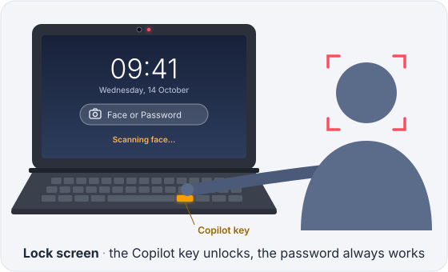

# omarchy-dell-xps-face

Face authentication for [Omarchy](https://omarchy.org) on Dell XPS laptops with the Windows Hello IR camera (Himax HM1092). sudo, polkit and the lock screen accept your face, but only after you press the Copilot key. Built as an overlay in Omarchy's layout, to go upstream as one pull request.

## Install

Until it is upstream, it runs on a checkout of Omarchy through Omarchy's own development tools, which means running Omarchy's development branch:

```
git clone https://github.com/renuo/omarchy-dell-xps-face && cd omarchy-dell-xps-face
(cd packaging/hm1092-ir-camera && makepkg -si)      # the IR camera driver, until Omarchy's repository has it
git clone https://github.com/omacom/omarchy ~/Work/omarchy/omarchy-installer
git clone https://github.com/omacom/omarchy-pkgs ~/Work/omarchy/omarchy-pkgs
bin/apply-to-checkout ~/Work/omarchy/omarchy-installer
omarchy dev pkg-test                                # install the checkout as packages
omarchy dev link ~/Work/omarchy/omarchy-installer   # run Omarchy from the checkout, then reboot
omarchy setup security face                         # enroll, and choose sudo and polkit, the lock screen, or both
```

`pkg-test` is needed besides the link because PAM, sudoers and systemd name the helpers by their `/usr/bin` paths. Remove an earlier clone of the lock or polkit plugin first (`omarchy plugin remove <you>.lock`), or it runs instead of the checkout's. `bin/run probe` checks the camera after the reboot.

Back to the release: `omarchy remove security face`, `omarchy dev unlink`, `sudo pacman -S omarchy omarchy-settings`.

## How it works

The Copilot key is the consent. Root reads it from the keyboard itself, so no program can press it for you, and the camera stays dark until you do. The password always works. If two prompts wait for the key at once, neither gets your face, and a notification names both.



sudo says "Press the Copilot key to use your face, or type your password." `sudo -n` and scripts never reach the camera.



The authentication dialog's field says "Face or Password".



A lock offers one scan within an hour of locking, both set in `/etc/omarchy/face.conf`; then only the password.

`docs/face-authentication.md` has the layers, contracts and known gaps.

## Develop

```
bash bin/setup                                           # shellcheck, jq, executable bits
bin/check                                                # lint and all tests
bin/apply-to-checkout ~/Work/omarchy/omarchy-installer   # after a change, then omarchy restart shell
omarchy dev pkg-test                                     # after a change to the helpers
bin/run                                                  # every manual test, step by step; --list names them
```

The checkout's diff is the pull request; `I18N_STRUCTURAL=1 ./test/shell` there is upstream's pull-request gate, and upstream's sync translates the new English strings. `bin/patch-shell-plugins` regenerates `shell/plugins` from a clean upstream checkout when upstream's plugins move. Dev scripts in `bin/` never take a system command's name, since a checkout's `bin/` may be first on PATH.

## Layout

```
bin/omarchy-*                      the commands: hardware check, setup and remove wizards, PAM helper, key service
default/                           the menu rows, the Copilot key binding, the English strings, and the
                                   key service's units, PAM services, lock limits and the lock screen's
                                   sudoers grant the setup copies
install/                           the first-run invitation; the setup installs the driver package itself
shell/plugins/                     upstream's lock and polkit plugins with the face added
packaging/hm1092-ir-camera/        the driver: DKMS sensor module and bridge entry, grayscale relay
test/shell.d/                      the suites; overlay-* stay here, the rest go upstream
```

## Status

Verified on a Dell XPS 14 DA14260 (Omarchy 4.0.4, Linux 7.2.5) with Enter as the consent; the Copilot key awaits its trial on the device. Applied to upstream's `quattro` at 84cfb93 it passes the translation gate and adds no failing test. The driver package belongs in Omarchy's package repository, next to `intel-ipu7-camera`.

## License

[MIT](LICENSE), with these exceptions:

- `shell/plugins/lock` and `shell/plugins/polkit` are derived from Omarchy's, MIT, copyright David Heinemeier Hansson.
- `packaging/hm1092-ir-camera` builds a GPL-2.0-only package: the sensor module comes from [jibsta210/svp7500-camera-fix-pack](https://github.com/jibsta210/svp7500-camera-fix-pack), and `hm1092-relay` is derived from [meros/hm1092-linux](https://github.com/meros/hm1092-linux).
